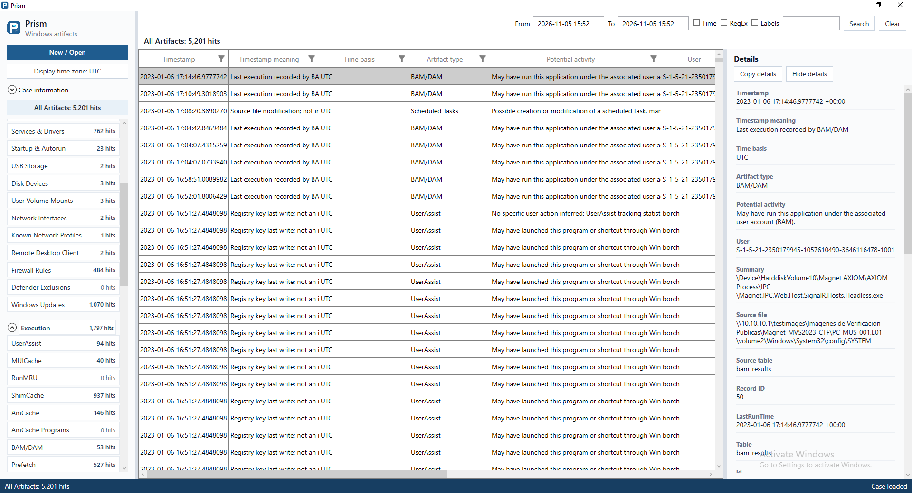
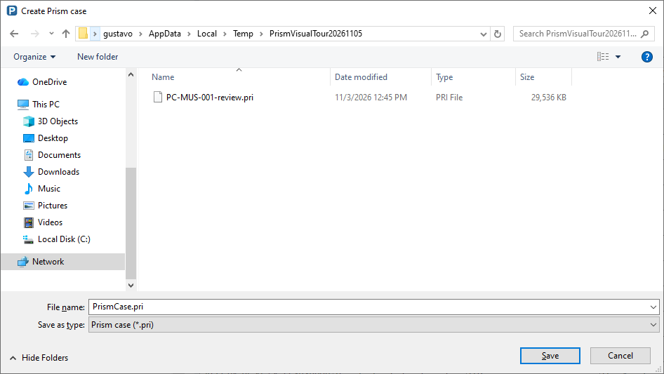
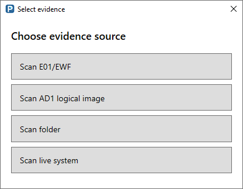
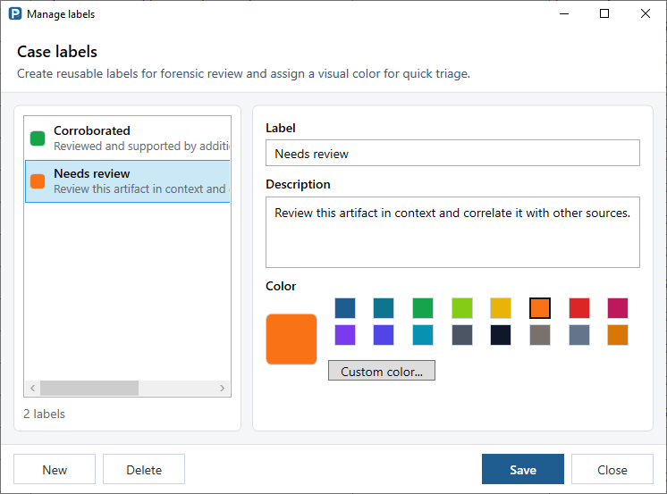
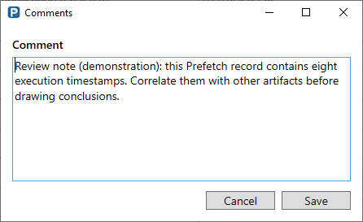
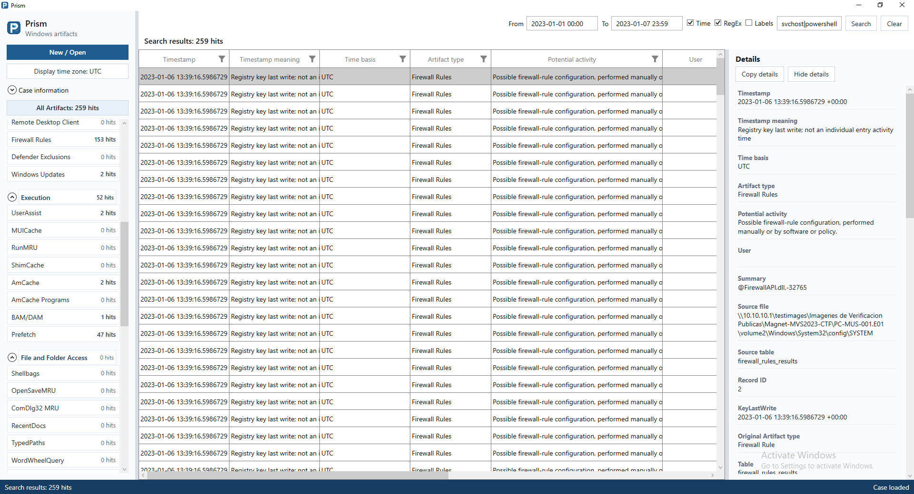
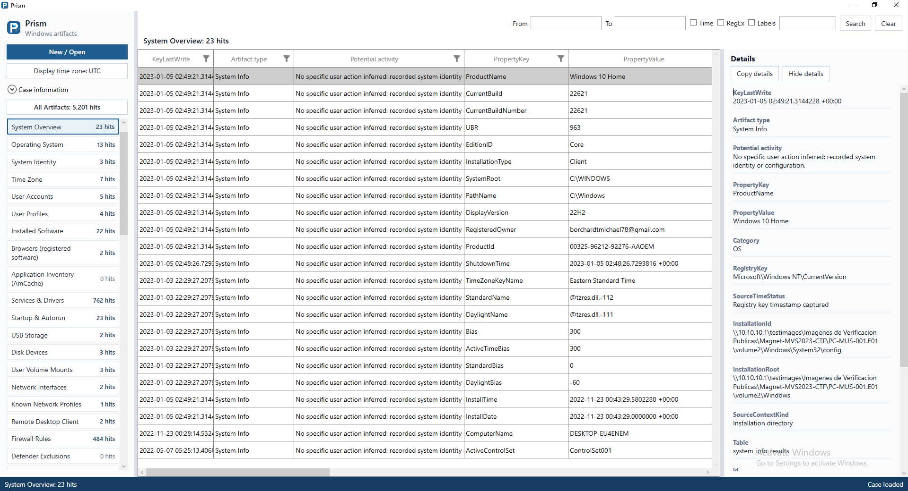

# Prism

[English](README.md) | [Español](README.es.md)

**Análisis y revisión de artefactos forenses de Windows.**

Prism lee fuentes de evidencia Windows compatibles, extrae registros estructurados
y permite revisar su contenido, timestamps y procedencia. Las investigaciones se
guardan en archivos de caso SQLite con extensión `.pri`.

**[Explorar el recorrido visual →](docs/es/visual-tour.md)** · Capturas reales de la aplicación
con la evidencia pública de entrenamiento PC-MUS-001.

| Crear un caso | Elegir la evidencia |
| --- | --- |
|  |  |

| Labels con color | Comentarios por registro |
| --- | --- |
|  |  |

| Búsquedas combinadas | Contexto del sistema |
| --- | --- |
|  |  |

El [recorrido completo](docs/es/visual-tour.md) también muestra categorías,
detalles de artefactos, labels en lote, anotaciones guardadas, filtros de columna
y el selector de zona horaria. Las anotaciones de ejemplo se hacen sobre una copia del caso.

## Estado del repositorio

Este es un **espacio privado de documentación** para preparar Prism 1.0.
**Aquí no se publican código fuente, ejecutables ni archivos de distribución.**
Hacer público el repositorio o incorporar software requiere una decisión posterior
del responsable. Documentar una capacidad no implica ofrecer una descarga.

## Capacidades

- Leer imágenes E01 compatibles, imágenes lógicas AD1 sin cifrar, carpetas de
  archivos originales y sistemas Windows vivos.
- Consumir E01, AD1 y carpetas directamente, sin extraer sus archivos fuente.
- En live, intentar primero la lectura normal y copiar temporalmente solo hives
  de registro autorizados que no se puedan leer normalmente. No se crean
  instantáneas del sistema operativo.
- Revisar artefactos individuales, categorías y All Artifacts en una grilla con filtros.
- Combinar búsquedas por fechas, texto, expresiones regulares y labels.
- Consultar detalles, aplicar labels y comentarios y conservar logs de procesamiento.
- Visualizar timestamps UTC con un offset elegido por el usuario, sin modificarlos
  en el caso.

El entorno de ejecución objetivo es **Windows 10/11 x64**. Esto no implica
cobertura completa de todos los formatos de artefactos o configuraciones Windows.

## Documentación

| Tema | Español | English |
|---|---|---|
| Recorrido visual | [Explorar la interfaz](docs/es/visual-tour.md) | [Visual tour](docs/en/visual-tour.md) |
| Primeros pasos | [Guía](docs/es/getting-started.md) | [Guide](docs/en/getting-started.md) |
| Fuentes de evidencia | [Fuentes](docs/es/evidence-sources.md) | [Sources](docs/en/evidence-sources.md) |
| Cobertura de artefactos | [Catálogo](docs/es/artifacts.md) | [Catalog](docs/en/artifacts.md) |
| Revisión de casos | [Flujo de revisión](docs/es/reviewing-cases.md) | [Workflow](docs/en/reviewing-cases.md) |
| Timestamps | [Tratamiento temporal](docs/es/timestamps.md) | [Time handling](docs/en/timestamps.md) |
| Validación y límites | [Validación](docs/es/validation.md) | [Validation](docs/en/validation.md) |
| Notas de la versión 1.0 | [Notas](docs/es/release-notes.md) | [Release notes](docs/en/release-notes.md) |
| Reportar problemas | [Cómo reportar](docs/es/reporting-problems.md) | [Reporting guide](docs/en/reporting-problems.md) |

El caso contiene resultados extraídos y anotaciones; no sustituye la evidencia
original. Conserva las fuentes por separado para permitir una revisión independiente.
