# Prism

[English](README.md) | [Español](README.es.md)

**Portable Windows forensic artifact analysis and review.**

Prism extracts and reviews Windows Registry artifacts and selected file-system
artifacts from **E01/EWF images, unencrypted AD1 logical images, folders and live
Windows systems**. Review records in one workspace, follow their timestamps and
sources, and organize findings with colored labels and comments. Cases are stored
in SQLite `.pri` files.

**Windows package:** [Releases](https://github.com/gustavoparedes/Prism/releases). Keep the complete extracted application folder together.

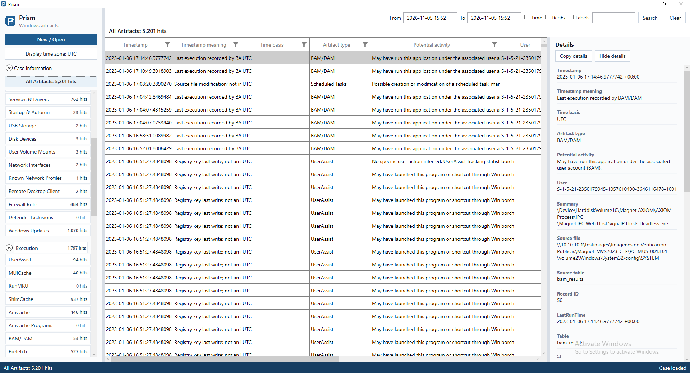

## Features

- **All Artifacts and category views:** review common fields across artifact families,
  or drill into one artifact and its complete extracted details.
- **System Profile:** inspect recorded OS, identity, user, software, device and
  configuration properties alongside their evidence sources.
- **Search and filtering:** combine time ranges, keywords, regular expressions and
  labels; refine results with native grid filters.
- **Labels and comments:** create reusable colored labels, apply them to one or
  several records, and add per-record observations.
- **Time display:** view known UTC instants with a selected fixed display offset,
  while retaining their stored timestamps and documented time basis.
- **Direct evidence access:** read E01, AD1 and folder sources in place. Live mode
  tries ordinary reads first and temporarily copies only authorized blocked
  registry hives, without operating-system snapshots.
- **Portable UI and CLI:** run the self-contained Windows 10/11 x64 application
  directly from a USB drive or network share, without installation. Supports
  interactive review and automated processing with a reduced deployment footprint.

## Windows artifacts

| Category | Examples |
| --- | --- |
| Execution | Prefetch, BAM/DAM, UserAssist, ShimCache, AmCache, RunMRU, MUICache |
| File and Folder Access | Shellbags, RecentDocs, OpenSaveMRU, TypedPaths, LNK, JumpLists, Recycle Bin |
| USB and Devices | Disk Devices, USBSTOR, MountPoints2, SetupAPI |
| Network and Remote Access | NetworkList, interfaces, RDP Client, firewall rules, Hosts |
| Persistence and System | Autorun, services, scheduled tasks, PowerShell history, installed software |
| System Profile | OS properties, identity, accounts, profiles, time-zone configuration and device inventory |

Coverage depends on the artifact format and evidence available; an extracted
record must be interpreted with its timestamp meaning and original source.

## Getting started

For a reduced footprint during live analysis, run Prism from a USB drive and save
its `.pri` case to that USB drive, or run it from a network share and save the case
to that share. Avoid saving the case on the examined system's internal drives.
Temporary copies of blocked registry hives are created alongside the `.pri`, in a
`<case-name>.live` folder, and are normally deleted after processing. Their location
follows the case destination, not the executable location. Windows can still
record execution and related activity; portable execution does not mean zero footprint.

Keep the complete portable application folder together and start `Prism.exe`.
Use an elevated process for live acquisition. The following walkthrough shows
**19 real screenshots** using the public PC-MUS-001 training evidence. Example
labels and comments were added to a separate review copy; they are demonstration
annotations, not findings about the evidence.

### Start a review

Create a new case or open an existing `.pri` case.

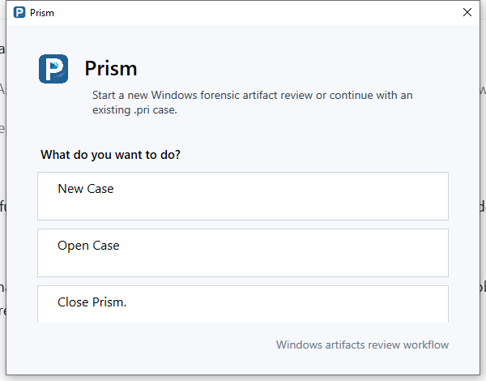

Choose **New Case**, then choose the name and location of the `.pri` file.

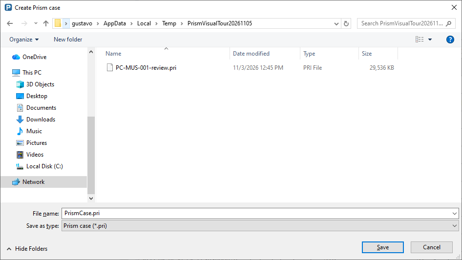

### Choose the evidence

Choose E01/EWF, an AD1 logical image, a folder or a live Windows system. Select
the evidence to start processing. The source selector below shows the setup
step; the review screenshots use the already processed CTF case.

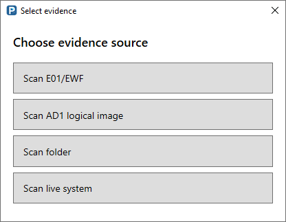

### Locate the case in its evidence

Expand **Case information** to see the source, processing start and completion
times, elapsed processing time and record counts. Collapse it to give more room
to artifact navigation.

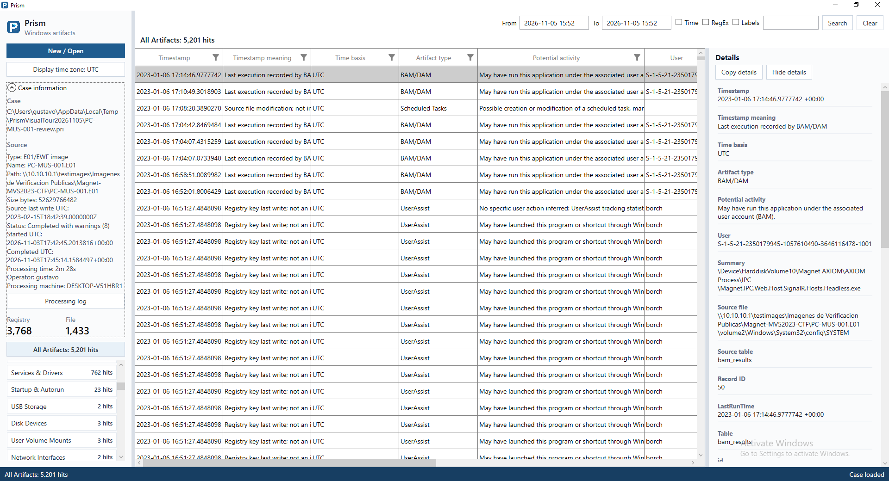

### All Artifacts

Review the case in one table with common fields, native column filters,
artifact navigation and selectable details. This case contains 5,201 artifacts.


### Explore a category

Select a category heading to combine its artifact families in one table. Select
a family to narrow the view. Counts help show which artifacts are present.

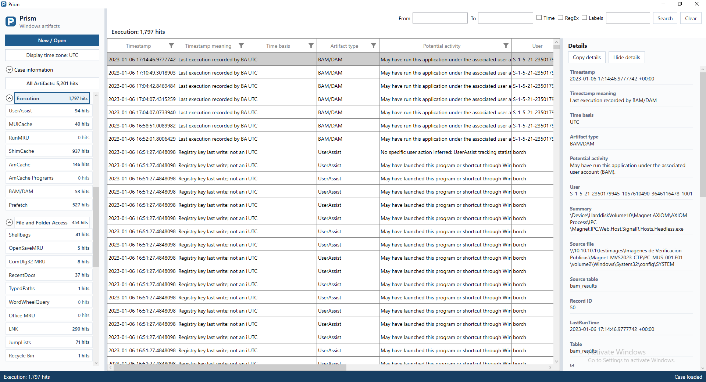

### Prefetch

Select an artifact family to review its records and the selected record's
extracted fields in Details. Timestamps retain their meaning and provenance.

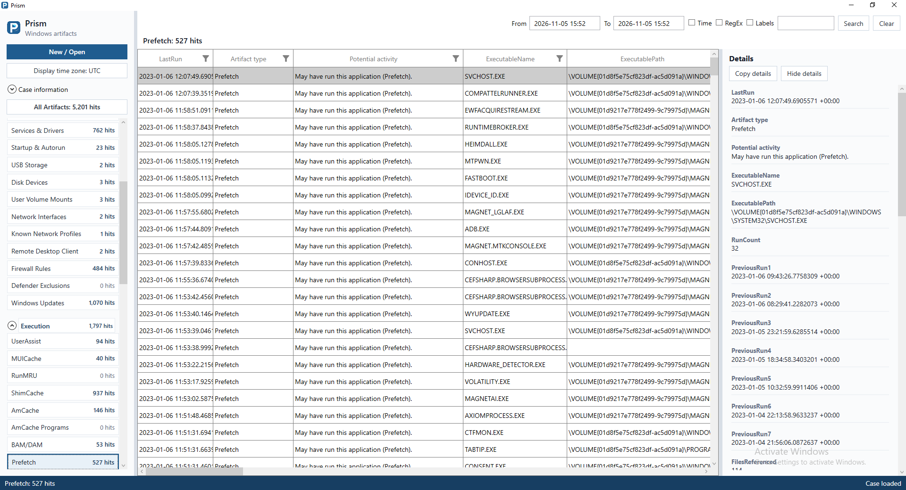

Other families have their own fields. Shellbags, for example, expose recorded
folder references and the registry provenance used to interpret them.

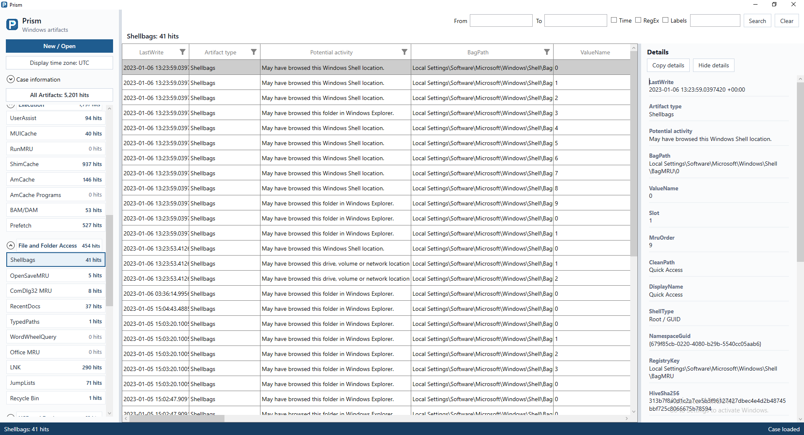

### Examine system context

System Profile groups recorded operating-system, identity, account, software,
device and configuration properties. Each record keeps its evidence source.

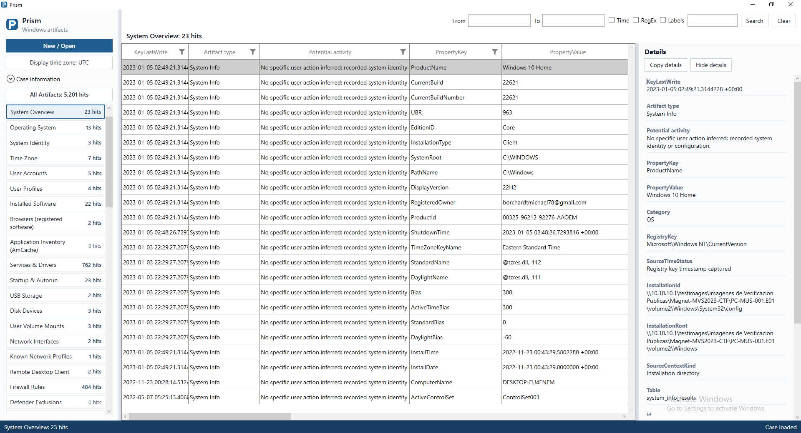

### Search across artifacts

Click **From** or **To** to open the calendar and choose a date, hour, minute
and second. Confirming enables the time filter; Cancel leaves the boundary unchanged.

Search by keyword or regular expression, with optional time and label filters.
Search results are combined across artifact families. Select a result to review
its extracted fields and matching text in Details.

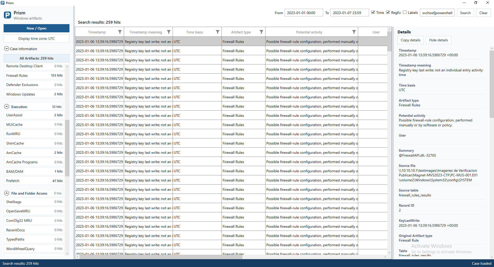

Enable **Labels** to combine the query with the requirement that a record has a
label. The following view combines a time range, a regex and a saved label.

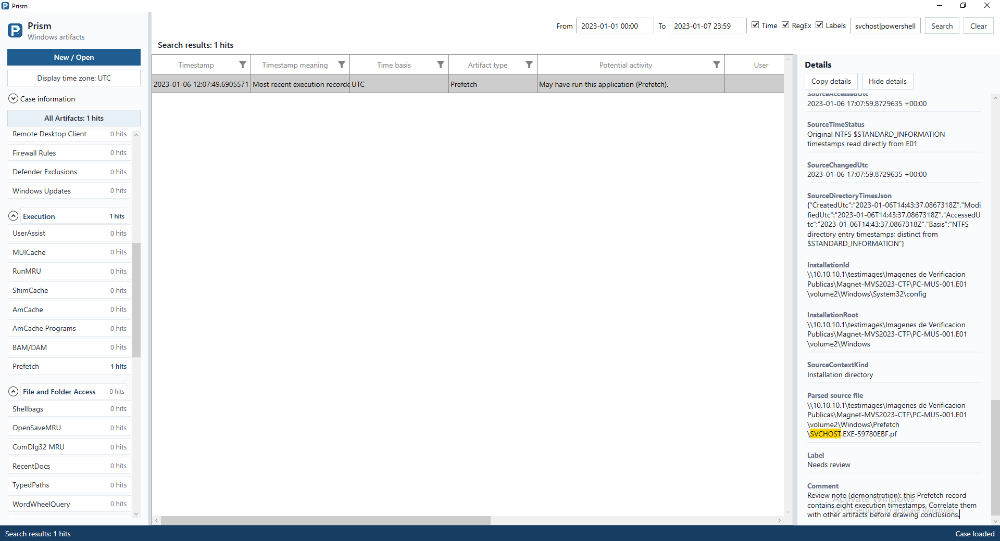

### Use the grid filters

Column filters refine the current view. Horizontal scrolling exposes additional
extracted fields; the navigation, results and Details panes can be resized.

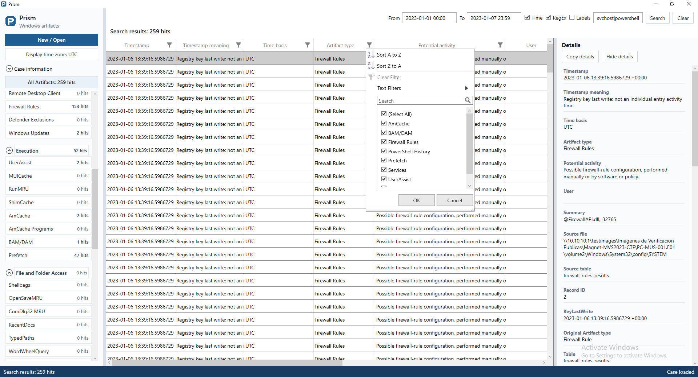

### Create colored labels

Right-click a result and open **Manage labels...**. Define a reusable name,
description and color for triage. These demonstration labels describe the review
workflow; a label does not change the underlying artifact.

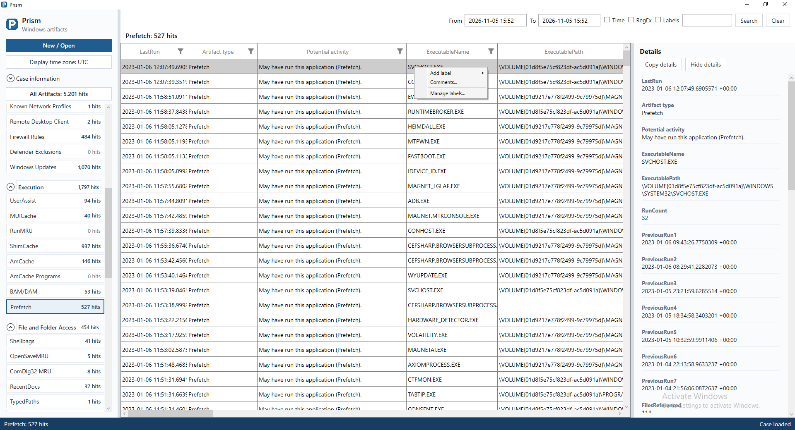

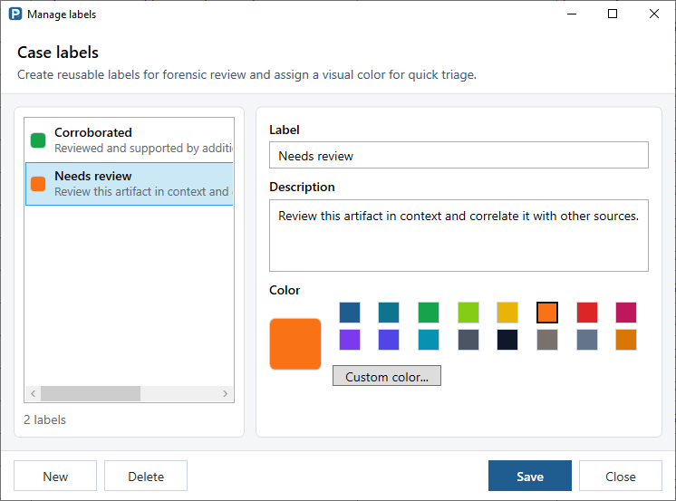

### Apply a label

The **Add label** submenu displays available names and colors. Select a label
to annotate a record. Multiple selected records can be labeled together.

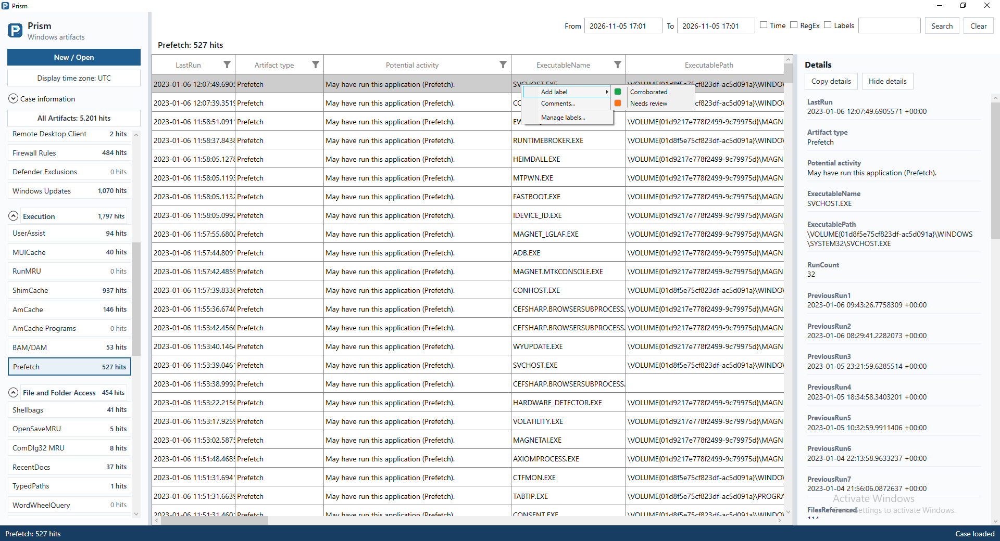

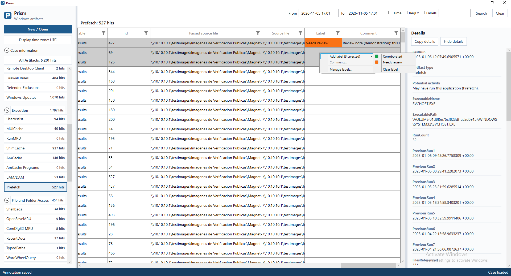

### Add a comment

Use **Comments...** on one record to record an observation, caveat or next step.
Comments and labels are stored in the case and appear with the reviewed record.

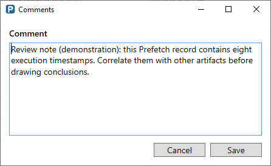

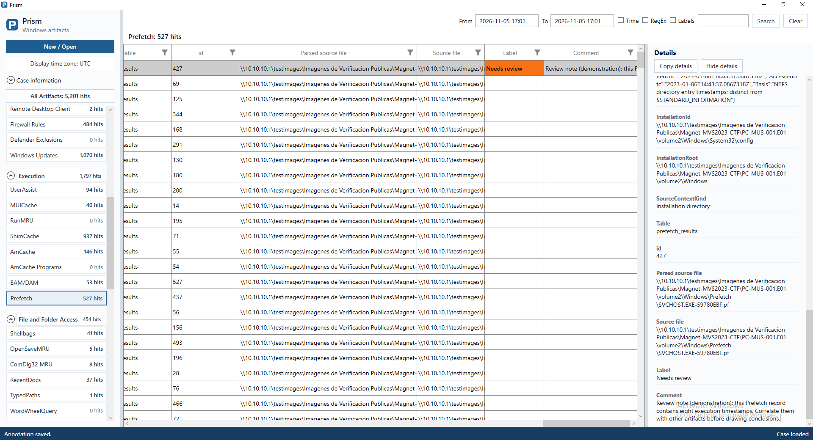

### Choose the display time zone

The display selector changes how known UTC instants are shown. It does not
rewrite stored timestamps. The listed UTC offset is applied as a fixed display
offset. Dates without a known UTC meaning retain their
documented time basis.

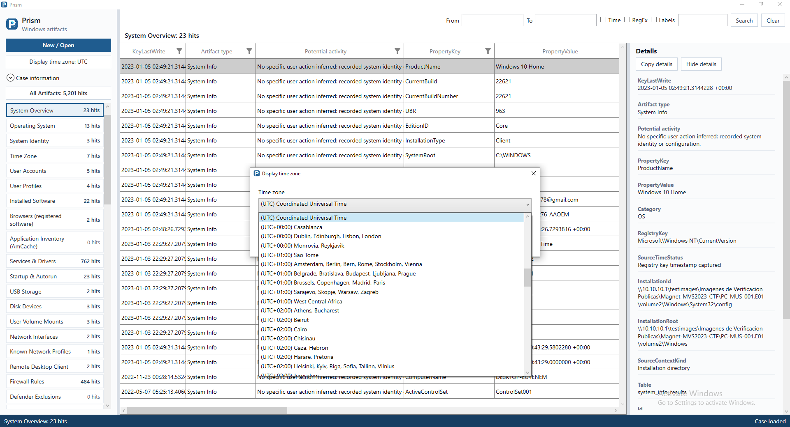

## Command-line usage

The CLI can process supported evidence without opening the review interface.
Run these examples from the application folder. Use a new `.pri` destination for
each processing run.

```powershell
.\CLI\Prism.Cli.exe scan --case D:\Cases\Image.pri --input D:\Evidence\Disk.E01 --kind e01
.\CLI\Prism.Cli.exe scan --case D:\Cases\Logical.pri --input D:\Evidence\Logical.ad1 --kind ad1
.\CLI\Prism.Cli.exe scan --case D:\Cases\Hives.pri --input D:\Evidence\Hives --kind folder
.\CLI\Prism.Cli.exe scan --case D:\Cases\Live.pri --input C: --kind live
```

Run live acquisition from an elevated terminal. The available kinds are `auto`,
`e01`, `ad1`, `folder` and `live`. Preserve original evidence separately from the extracted case.

## Build from source

Use the .NET 8 SDK or a compatible newer SDK on Windows.

```powershell
dotnet restore Prism.sln
dotnet build Prism.sln -c Release
dotnet publish Prism.Wpf/Prism.Wpf.csproj -c Release -r win-x64 --self-contained true -o publish/UI
dotnet publish Prism.Cli/Prism.Cli.csproj -c Release -r win-x64 --self-contained true -o publish/CLI
```

The UI uses Syncfusion controls. For your own builds, register an appropriate
license through `PRISM_SYNCFUSION_LICENSE_KEY` or an ignored local
`syncfusion-license.txt` file. No activation file is included in the repository.

Prism is distributed under the [GNU GPL v3.0 license](LICENSE). Dependency licenses and
notices are retained in [licenses](licenses) and
[THIRD-PARTY-NOTICES.json](THIRD-PARTY-NOTICES.json).
## Acknowledgements

Prism stands on the shoulders of giants. We thank the authors and maintainers who share their work, document Windows artifacts and make forensic research reproducible.

- **Eric Zimmerman and contributors**, for Registry, Prefetch, JumpList, Lnk, AppCompatCache and their supporting libraries. Their work provides essential building blocks for reading Windows forensic artifacts.
- **The DiscUtils contributors**, for their file-system libraries, including NTFS support.
- **The libyal/libewf and zlib contributors**, for the libraries used to read E01/EWF evidence.
- **The SQLite, System.Data.SQLite and .NET/WPF contributors**, for the storage and application foundations, and **Syncfusion**, for the grid controls used in the review interface.
- **[Kevin Pagano — Stark4n6](https://www.stark4n6.com/)**, for the forensic write-ups used as references during Prism validation and for sharing his analysis with the community.
- **NIST and the forensic community**, for public test evidence, format documentation, research and shared knowledge that help us validate and improve Prism.

Our thanks also go to everyone who tests Prism, reports problems and helps improve the tool. The complete dependency notices and licenses are available in [THIRD-PARTY-NOTICES.json](THIRD-PARTY-NOTICES.json) and [licenses](licenses).
