# Visual tour

[Documentation home](../../README.md) | [Español](../es/visual-tour.md)

Follow a review from case creation through navigation, filtering and annotations.
These are real Windows screenshots of Prism, captured on November 5, 2026,
using the public PC-MUS-001 training evidence. Labels and comments shown here
are demonstration annotations made in a separate copy of that case; they are
not findings about the evidence.

## Start a review

Create a new case or open an existing `.pri` case.

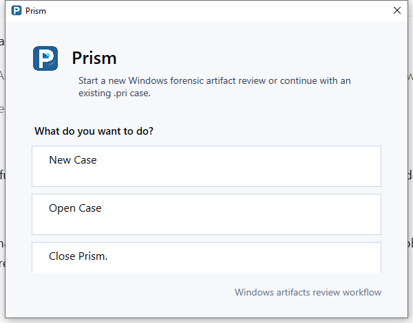

Choose **New Case**, then choose the name and location of the `.pri` file.

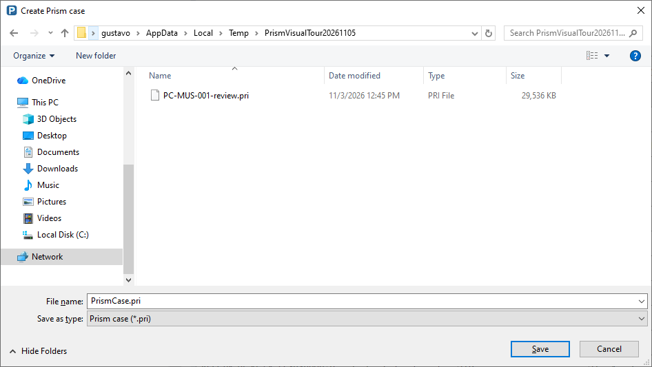

## Choose the evidence

Choose E01/EWF, an AD1 logical image, a folder or a live Windows system. Select
the evidence to start processing. The source selector below shows the setup
step; the review screenshots use the already processed CTF case.

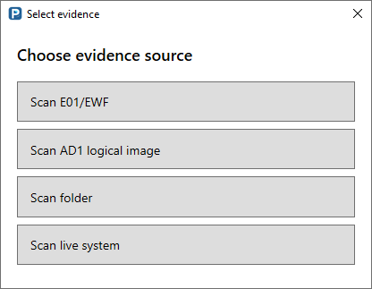

## Locate the case in its evidence

Expand **Case information** to see the source, processing start and completion
times, elapsed processing time and record counts. Collapse it to give more room
to artifact navigation.

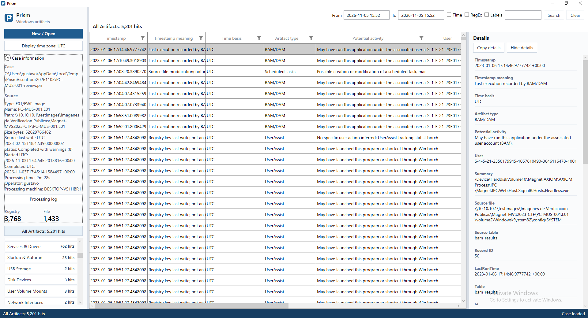

## All Artifacts

Review the case in one table with common fields, native column filters,
artifact navigation and selectable details. This case contains 5,201 artifacts.

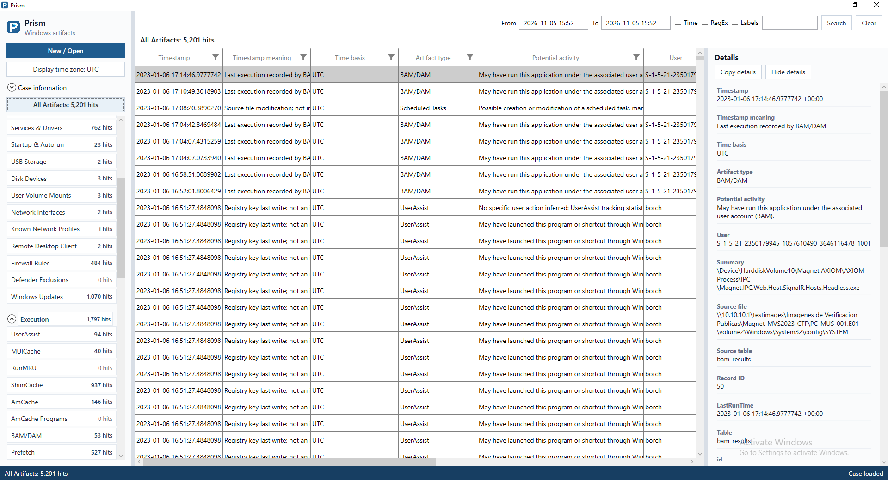

## Explore a category

Select a category heading to combine its artifact families in one table. Select
a family to narrow the view. Counts help show which artifacts are present.

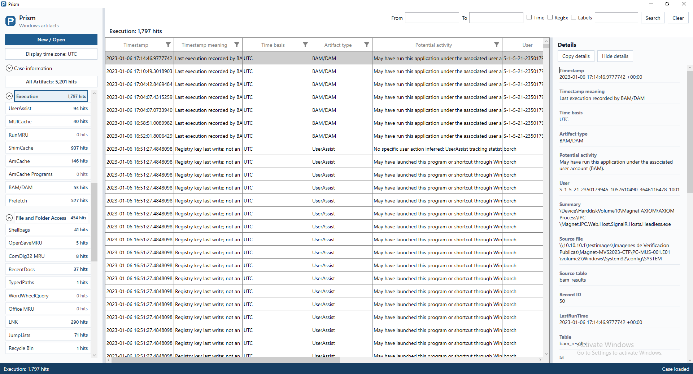

## Prefetch

Select an artifact family to review its records and the selected record's
extracted fields in Details. Timestamps retain their meaning and provenance.

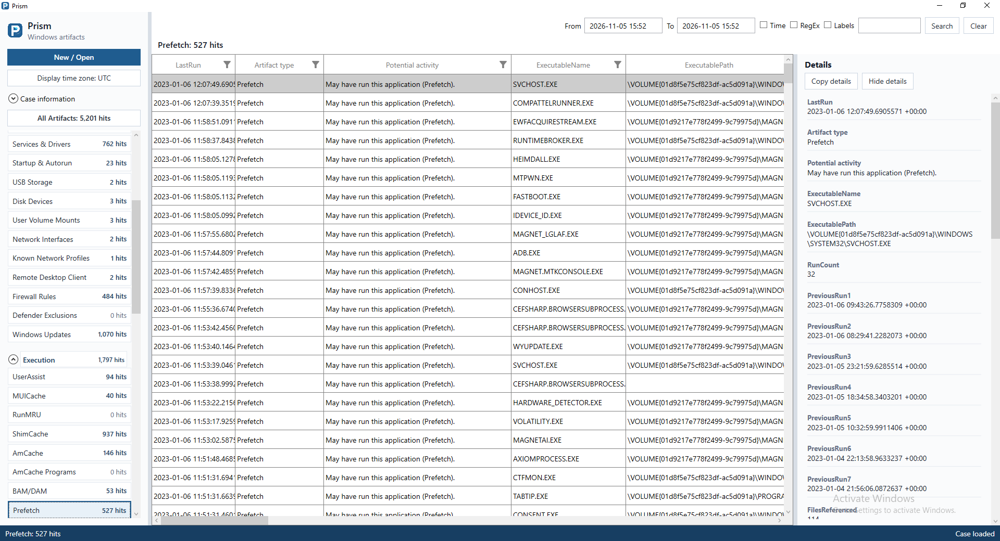

Other families have their own fields. Shellbags, for example, expose recorded
folder references and the registry provenance used to interpret them.

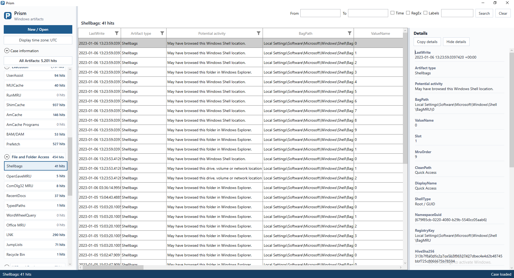

## Examine system context

System Profile groups recorded operating-system, identity, account, software,
device and configuration properties. Each record keeps its evidence source.

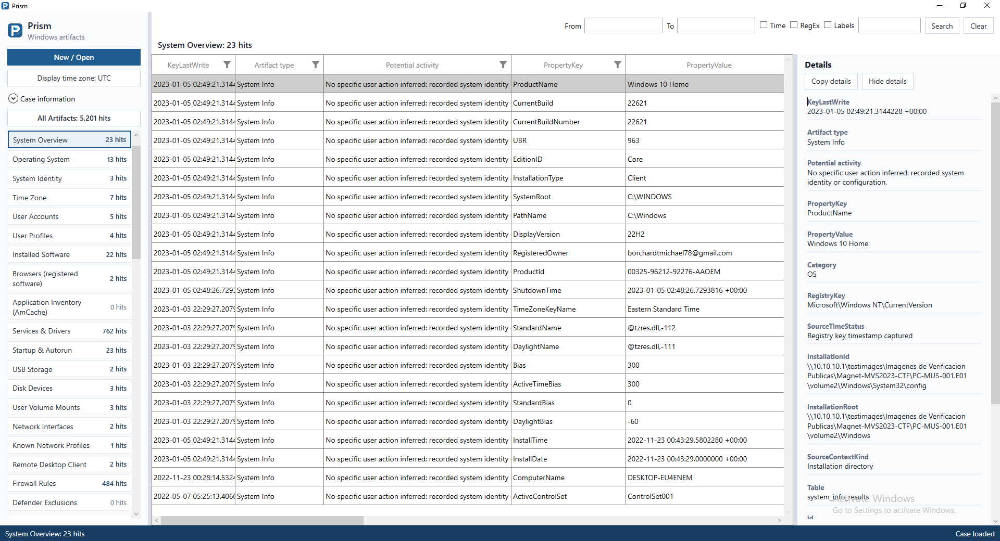

## Search across artifacts

Search by keyword or regular expression, with optional time and label filters.
Search results are combined across artifact families. Select a result to review
its extracted fields and matching text in Details.

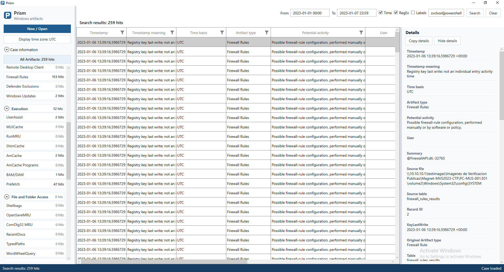

Enable **Labels** to combine the query with the requirement that a record has a
label. The following view combines a time range, a regex and a saved label.

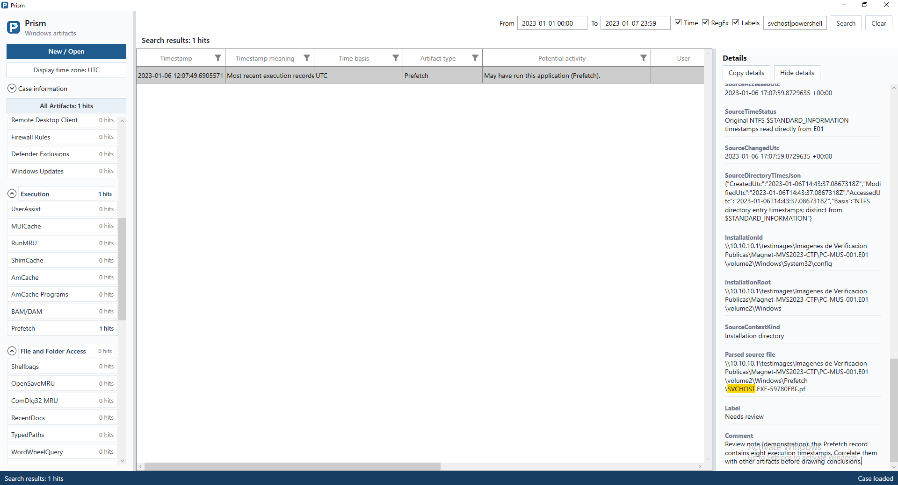

## Use the grid filters

Column filters refine the current view. Horizontal scrolling exposes additional
extracted fields; the navigation, results and Details panes can be resized.

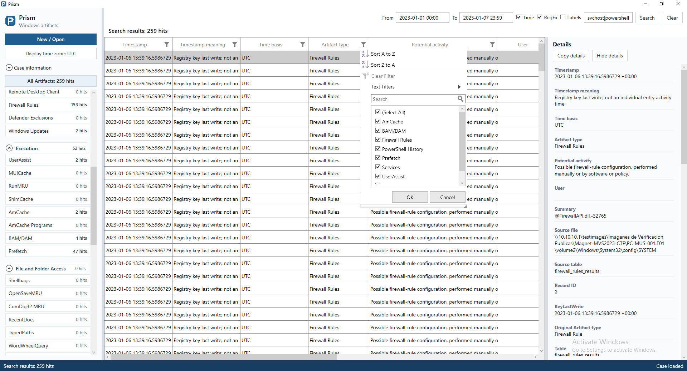

## Create colored labels

Right-click a result and open **Manage labels...**. Define a reusable name,
description and color for triage. These demonstration labels describe the review
workflow; a label does not change the underlying artifact.

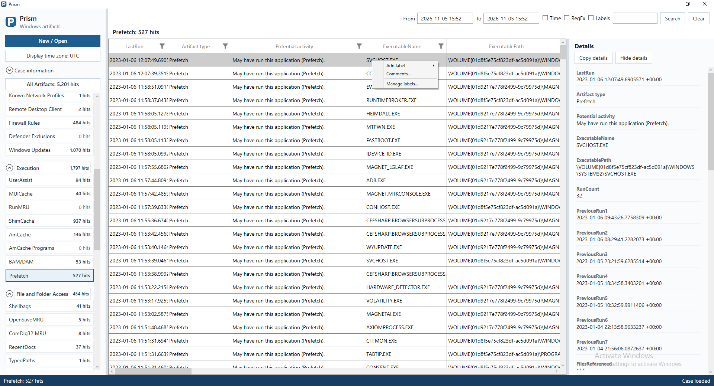

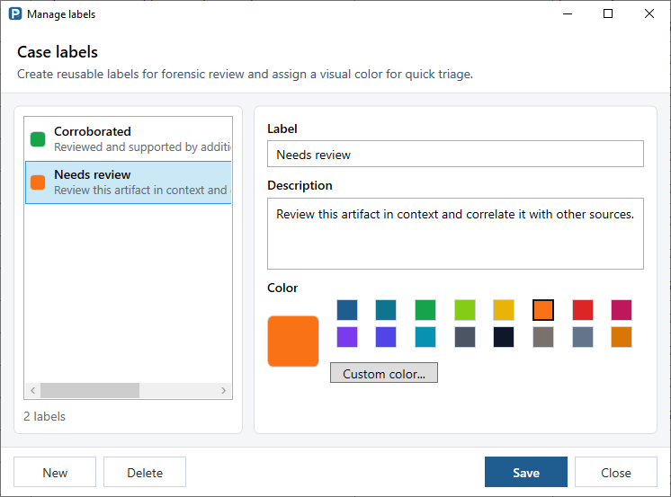

## Apply a label

The **Add label** submenu displays available names and colors. Select a label
to annotate a record. Multiple selected records can be labeled together.

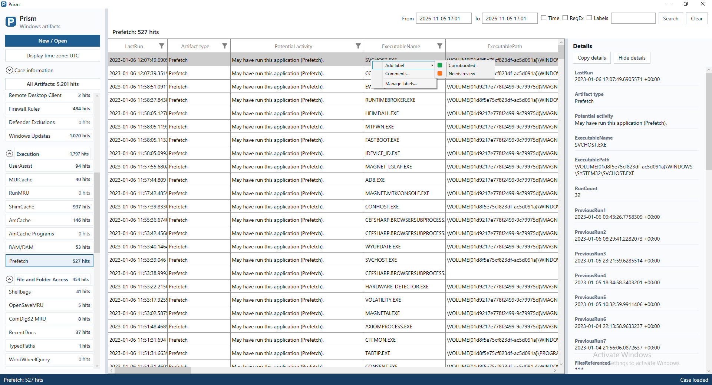

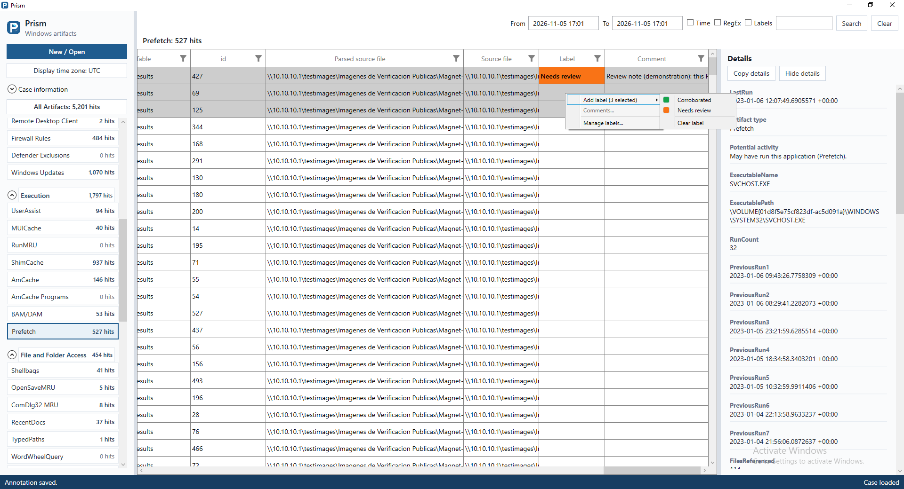

## Add a comment

Use **Comments...** on one record to record an observation, caveat or next step.
Comments and labels are stored in the case and appear with the reviewed record.

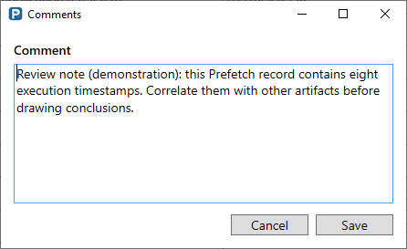

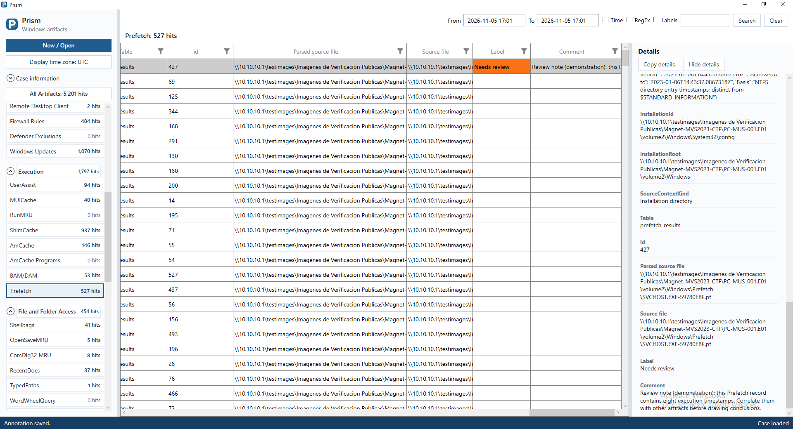

## Choose the display time zone

The display selector changes how known UTC instants are shown. It does not
rewrite stored timestamps. The listed UTC offset is applied as a fixed display
offset. Dates without a known UTC meaning retain their
documented time basis.

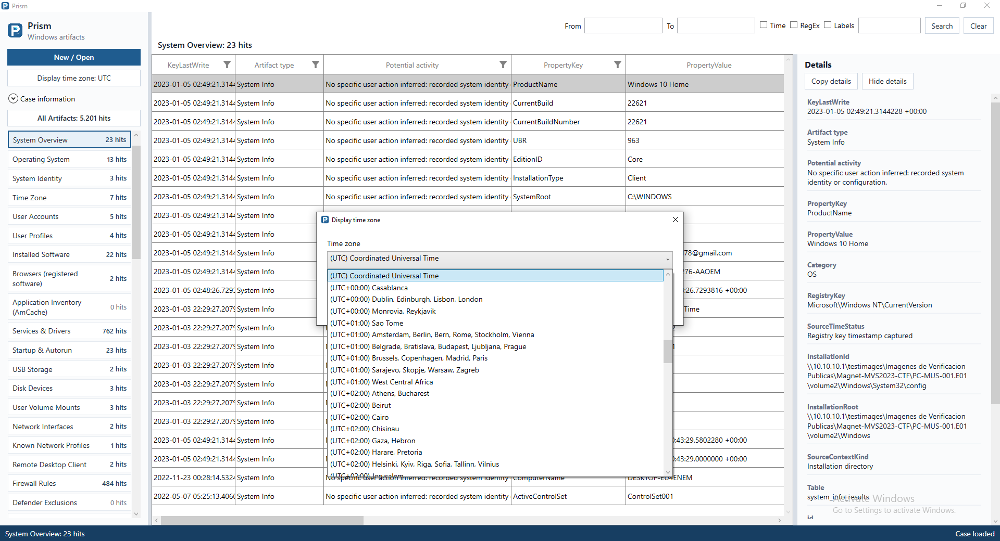
