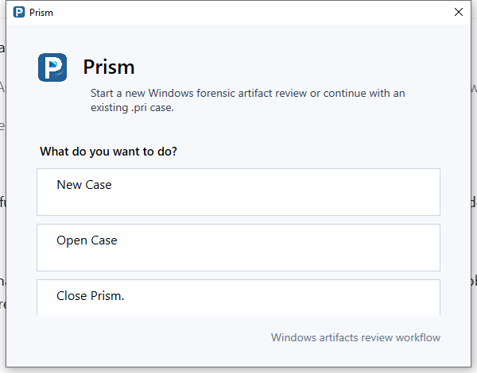
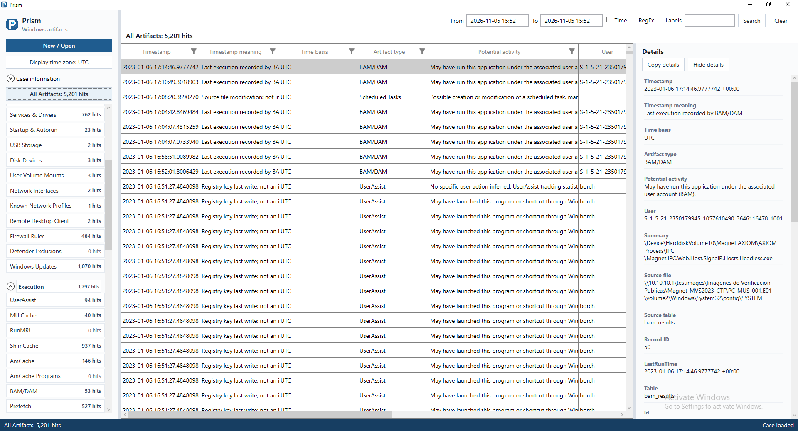
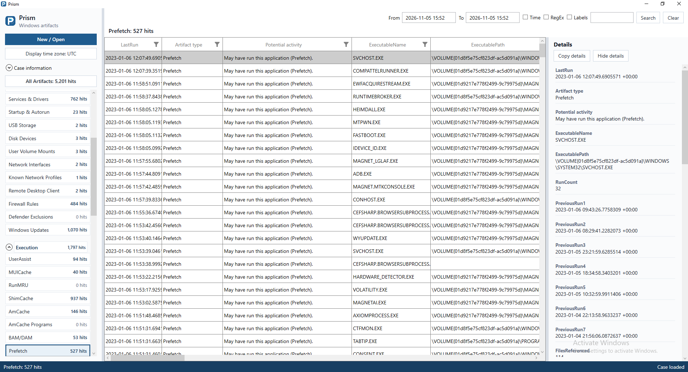

# Recorrido visual

[Inicio de documentación](../../README.es.md) | [English](../en/visual-tour.md)

Capturas reales de Prism en Windows, tomadas el 5 de noviembre de 2026,
con la evidencia pública de entrenamiento PC-MUS-001.

## Iniciar una revisión

Crea un caso nuevo o abre un caso `.pri` existente.

## All Artifacts

Revisa el caso en una tabla con campos comunes, filtros nativos por columna,
navegación por artefactos y detalles seleccionables. Este caso contiene 5.201 artefactos.

## Prefetch

Selecciona una familia de artefactos para revisar sus registros y los campos
extraídos del registro seleccionado en Details. Los timestamps conservan su
significado y procedencia.

